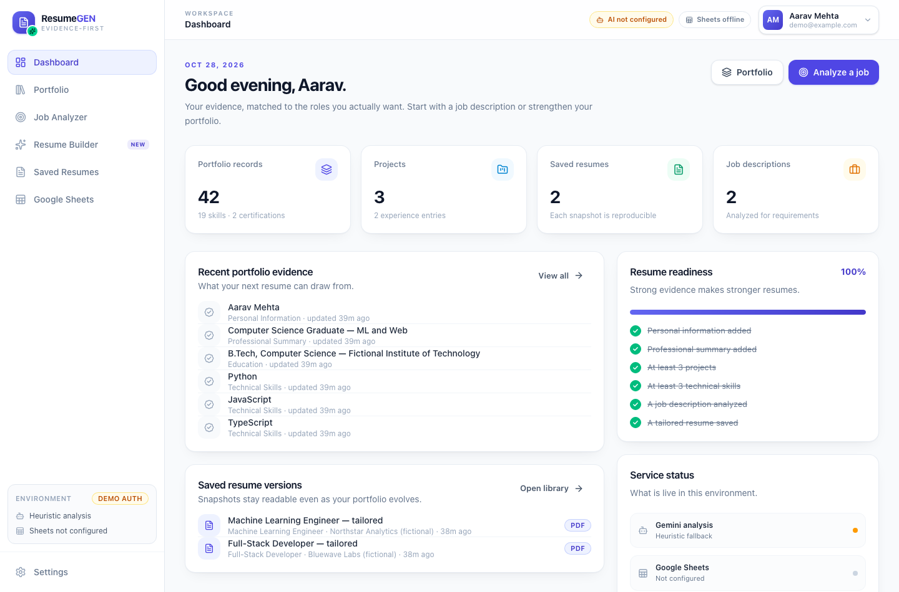
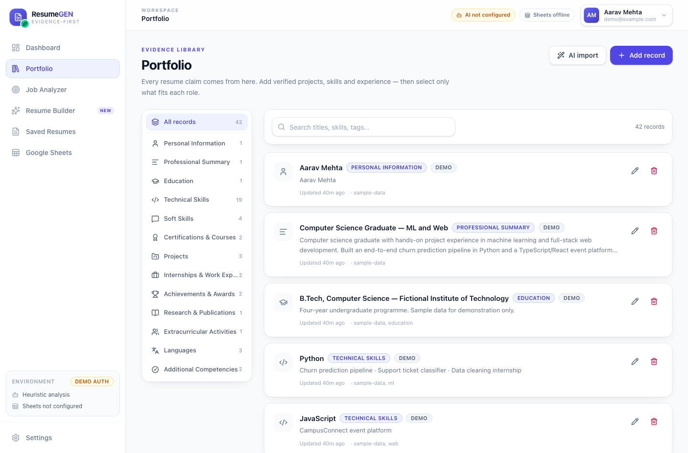
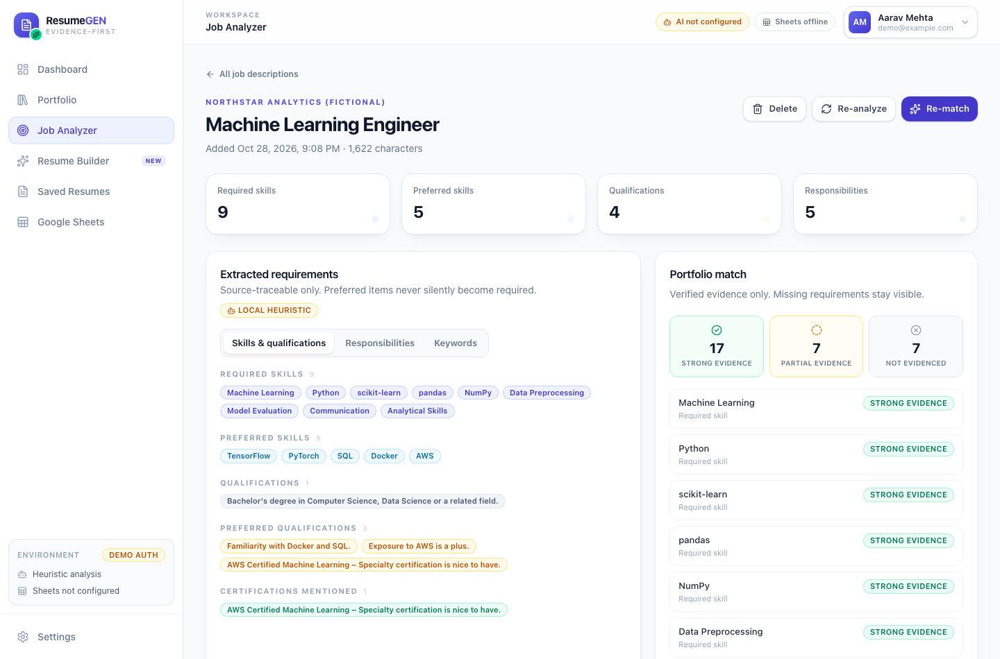
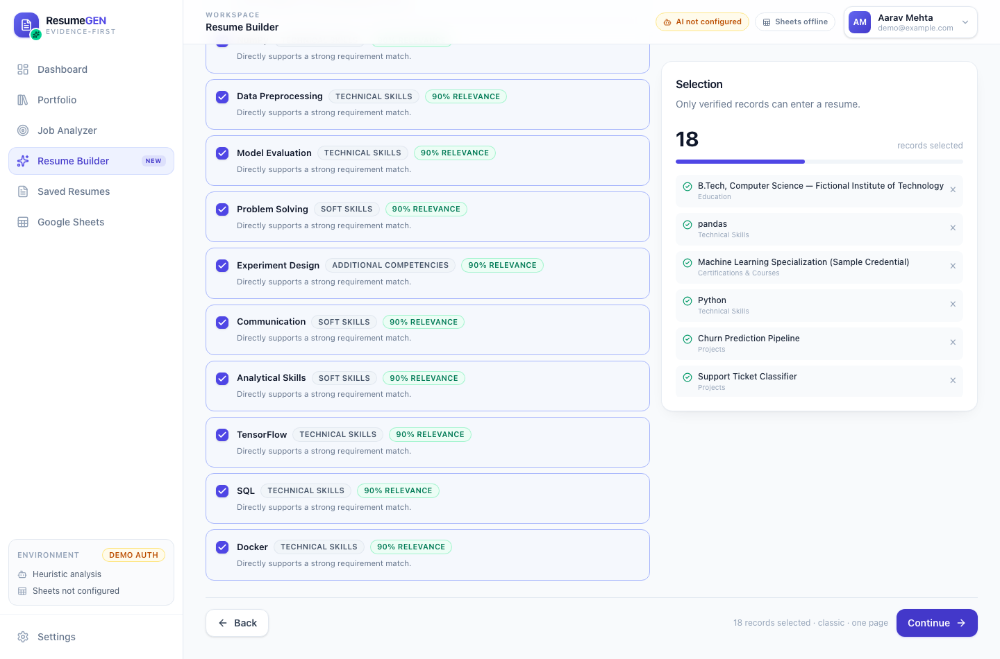
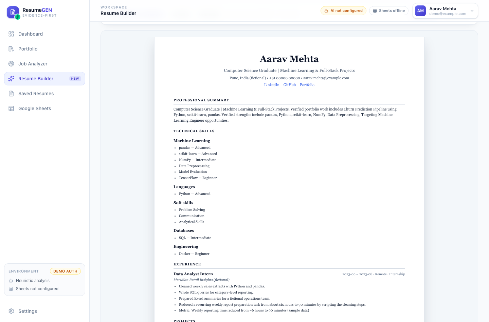
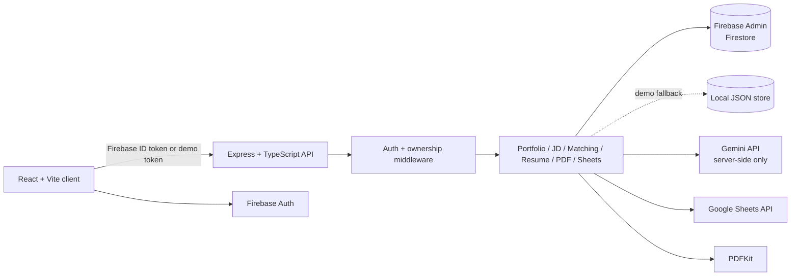

# ResumeGEN

**Evidence-first portfolio management and job-specific resume generation.**

ResumeGEN keeps a verified portfolio of your real work, analyzes a job description into
requirements, matches those requirements against your evidence, and assembles an ATS-friendly
resume you can preview, save as an immutable snapshot and export as a PDF.

The project is a complete working application in **local demo mode**. Gemini, Firebase and Google
Sheets integrations are implemented but were not exercised against live credentials in this
environment — see [Integration status](#integration-status).



## What it does

- **Portfolio workspace** — 13 record types (personal info, summary, education, technical/soft
  skills, certifications, projects, experience, achievements, publications, activities, languages,
  competencies), search, category filters, verified/unverified states, and AI-assisted text
  structuring with a review step.
- **Job analyzer** — pastes a posting, extracts required/preferred skills, qualifications,
  responsibilities, keywords and experience, then shows requirement-level evidence matches.
- **Honest matching** — `strong`, `partial`, and `not_evidenced` statuses. Only verified portfolio
  records can be selected. Missing requirements stay visible and are never auto-added.
- **Six-step resume builder** — target role → match review → evidence selection → customization
  (title, summary, contact overrides, section order, template, layout) → live preview + exact server
  PDF → save/export.
- **Reproducible snapshots** — saved resumes store the full document, selections and settings.
  Later portfolio edits mark a snapshot **outdated** instead of silently changing it.
- **PDF export** — three single-column templates, one/two-page preference, wrapping, multipage flow,
  safe clickable links, safe filenames, no-store responses.
- **Google Sheets** — preview the workbook, sync each category tab by stable record ID, and review
  sheet edits before importing them. Firestore remains authoritative.
- **Security** — server-verified bearer tokens, per-user ownership on every query, Zod validation,
  rate limits, sanitization, safe logging, deny-all direct Firestore client rules.
- **Honest fallbacks** — when Gemini is absent, deterministic heuristics run and the UI says so. No
  result is labelled AI when it was not produced by AI.

### Screens

| Portfolio | Job matching |
| --- | --- |
|  |  |

| Evidence selection | Resume preview |
| --- | --- |
|  |  |

## Architecture



The React client never receives a Gemini key or a service-account key and never reads Firestore
directly. `shared/` contains the Zod schemas and domain types used by both apps.

## Quick start

Requirements: **Node.js 22+**, npm. Ports **5050** (API) and **5173** (web) are used because macOS
AirPlay commonly occupies port 5000.

```bash
npm run install:all
cp .env.example .env
npm run seed       # fictional demo portfolio + two sample jobs
npm run dev        # API on :5050, web on :5173
```

Open <http://localhost:5173>, enter `demo@example.com` (the field is prefilled), and click **Enter
workspace**. `npm run seed` is idempotent: re-running it skips records and jobs that already exist.

> `.env` is ignored by git. The checked-in `.env.example` contains placeholders only. The local demo
> store lives at `Backend/.data/db.json`, also ignored.

### Scripts

| Command | Purpose |
| --- | --- |
| `npm run dev` | Run API and frontend together. |
| `npm run dev:backend` / `npm run dev:frontend` | Run one side. |
| `npm run seed` | Seed the local demo workspace with fictional data. |
| `npm run typecheck` | TypeScript checks for backend and frontend. |
| `npm run lint` | ESLint for the frontend. |
| `npm run test` | Vitest suites for backend and frontend. |
| `npm run test:e2e` | Playwright browser flow; requires `npm run dev` and seeded data. |
| `npm run screenshots` | Regenerate `docs/screenshots/` with the dev servers running. |
| `npm run build` | Compile the API bundle and build the frontend. |
| `npm start --prefix Backend` | Run the API from source with `tsx`. |

The Playwright verification scripts are documented in [docs/testing.md](docs/testing.md).

## Integration status

| Area | State in this repository | What still needs configuration |
| --- | --- | --- |
| Local demo auth + JSON store | **Working and tested** | None for demo use. |
| Portfolio / jobs / matching / builder / saved resumes | **Working and tested** | None. |
| PDF preview, download, saved snapshot PDF | **Working and tested** | None. |
| Deterministic JD analysis and matching | **Working and tested** | None; UI labels it `heuristic`. |
| Gemini analysis, matching merge, summary, suggestions | Implemented, schema-validated, unit-tested with mocks | A real `GEMINI_API_KEY`; live calls were not verified here. |
| Firebase Auth + Firestore | Implemented; demo auth is active without credentials | Firebase project, Admin credentials, client `VITE_FIREBASE_*`, deployed rules. |
| Google Sheets sync/preview/import | Implemented; workbook and upsert logic unit-tested | Google service account with Sheets API, a shared spreadsheet, `GOOGLE_SHEETS_SPREADSHEET_ID`; live API calls were not verified here. |

Health check: `GET http://localhost:5050/api/health` reports `authMode`, `aiConfigured` and
`sheetsConfigured`. In the current environment it returns demo auth, AI not configured and Sheets
not configured.

## Configuration

Copy `.env.example` to `.env`. Key variables:

| Variable | Meaning |
| --- | --- |
| `PORT` | API port, default `5050`. |
| `FRONTEND_URL` | Comma-separated allowed origins. |
| `DEMO_MODE` | `auto` (default), `true` or `false`. Demo auth is used when no Firebase Admin credentials exist. |
| `SESSION_SECRET` | Required in production; signs demo tokens. Generate with `openssl rand -hex 32`. |
| `DB_FILE` | Local demo JSON store. Use `:memory:` in tests. |
| `GEMINI_API_KEY` / `GEMINI_MODEL` | Server-side Gemini configuration. Never expose the key to the client. |
| `GOOGLE_APPLICATION_CREDENTIALS` | Service-account JSON for Firebase Admin and Google Sheets. |
| `FIREBASE_PROJECT_ID`, `FIREBASE_CLIENT_EMAIL`, `FIREBASE_PRIVATE_KEY` | Alternative to the JSON file. |
| `GOOGLE_SHEETS_SPREADSHEET_ID` | Default spreadsheet; can also be set from the Sheets page. |

Frontend Firebase values (`VITE_FIREBASE_*`) belong in `Frontend/.env` and are public identifiers,
not secrets.

## Project layout

```text
Backend/                 Express + TypeScript API, repositories, services, tests
  src/config/            Environment, Firebase Admin, Google clients
  src/controllers/       Thin request/response layer
  src/middleware/        Auth, validation, rate limiting, errors
  src/repositories/      Local JSON + Firestore implementations
  src/services/          Portfolio, JD, Gemini, matching, resume, PDF, Sheets, seed
  tests/                 Vitest + Supertest API/unit tests
Frontend/                React 19 + Vite + TypeScript + Tailwind v4
  src/pages/             Login, dashboard, portfolio, jobs, builder, resumes, sheets, settings
  src/components/        UI primitives, layout, resume preview, PDF viewer
  src/lib/               API client, pure builder helpers, utilities
  src/test/              Vitest/jsdom setup
shared/                  Zod schemas, canonical types, categories, sheet tab mapping
docs/                    API, database, Sheets, testing, demo and screenshot guides
scripts/                 Seed, Playwright E2E, screenshot capture
firestore.rules          Deny-all direct client access (API/Admin SDK only)
```

## Data and privacy

- All records are scoped by the **server-derived** auth `uid`. A client-supplied `uid` is ignored.
- Resume documents and PDFs are regenerated server-side from selections and settings; the server
  does not persist arbitrary client-supplied documents.
- AI output is validated with Zod. Summary claims are rejected when numbers, skills, certifications
  or years of experience are not grounded in the selected portfolio records.
- Job-description text is treated as untrusted data; obvious prompt-injection lines are filtered from
  heuristic input and the prompt instructs the model to ignore embedded instructions.
- Logs contain method, path, status and duration only — no bodies, tokens or job text.
- Seeded data and all sample companies/people are fictional.

See [docs/database-schema.md](docs/database-schema.md) for the model and rules, and
[docs/api-documentation.md](docs/api-documentation.md) for the endpoint contract.

## Tests

```bash
npm run typecheck
npm run lint
npm run test
npm run build
```

Last verified on 2026-10-28 in demo mode: **72 backend tests passing**, **20 frontend tests passing**,
backend/frontend production builds passing, and a **17-check Playwright browser flow passing** against
the running dev servers (login, portfolio search, job matching, all six builder steps, exact PDF,
save, PDF download, saved library, Sheets offline state, settings, mobile navigation, zero console
errors, self-cleanup). See [docs/testing.md](docs/testing.md) for coverage and caveats.

## Known limitations

- Live Gemini, Firebase Admin/Firestore and Google Sheets calls are **not verified** without
  credentials. Their deterministic/mocked behavior is tested; the live integration still needs a
  smoke test in the target project.
- `firestore.rules` is checked in but has not been deployed or tested against the Firestore emulator.
- Demo authentication is for local review only. Use Firebase Authentication and a strong
  `SESSION_SECRET` in production.
- The HTML preview and PDF use the same generated document and section content, but different
  renderers (React/DOM vs PDFKit). Typography and line wrapping can differ by a small amount; the
  **Exact PDF** tab and the download use the same server renderer.
- "Prefer one page" is a layout preference, not a hard truncation. Long resumes flow onto additional
  pages rather than clipping content.
- Rate limiting is in-memory and per API instance. Use a shared store when running multiple replicas.
- The Google Sheets import never trusts spreadsheet edits blindly: changed records are imported with
  `needs_review` status so they cannot enter a resume until re-verified.

## Documentation

- [Database schema and security rules](docs/database-schema.md)
- [API documentation](docs/api-documentation.md)
- [Google Sheets setup](docs/google-sheets-setup.md)
- [Testing and verification](docs/testing.md)
- [Demo script](docs/demo-script.md)
- [Screenshot checklist](docs/screenshot-checklist.md)
- [Video script](docs/video-script.md)
- [Sample job descriptions](docs/samples/)

## License

MIT.
